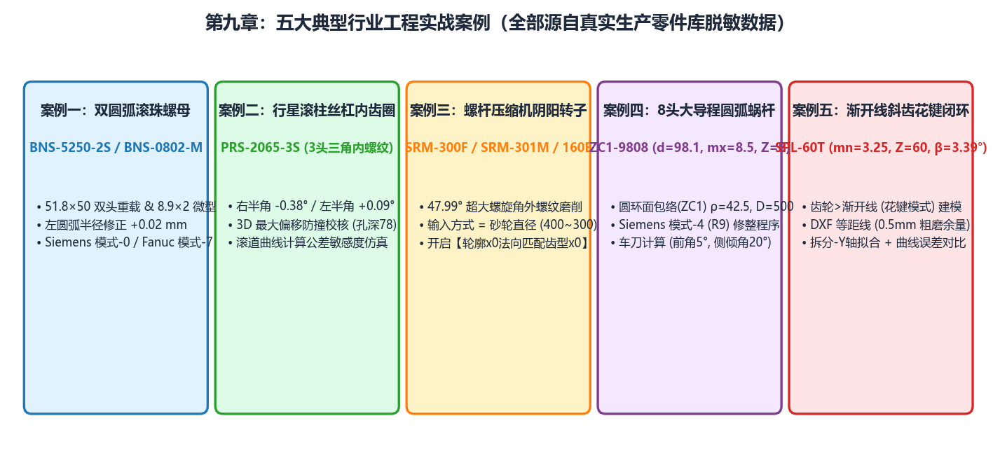

# 第 9 章 典型工程实战案例集（5 大行业标准场景）

本章精选自精密传动、新能源电驱、流体机械及机器人减速器行业的 **5 大代表性工业应用案例**，串联演示如何组合运用 **IGD** 的 `绘图工具`、`工具箱`、`基本参数` 与 `高级参数`，解决大导程内螺纹防撞、微型螺母反算、压缩机阴阳转子非对称修整、ZC1 蜗杆磨削与粗车刀设计、以及渐开线花键逆向 DXF 处理等高难度工程问题。

---

## 五大实战案例速查矩阵

| 案例章节 | 标准工程代号 | 工件类型与齿形特征 | 涉及核心模块与关键技术点 | 数控程序模式 |
| :--- | :--- | :--- | :--- | :--- |
| **[9.1 案例一](./case1_double_arc_nut.md)** | **`BNS-5250-2S`** **`BNS-0802-M`** **`BNS-2208-FN`** | 内螺纹双圆弧滚珠丝杠螺母（含重载双头大导程与微型螺母） | `螺纹 -> 双圆弧`（正向 `计算` + 逆向 `反算` + `#6bb1aa` 微调）➔ `工具箱 -> 最大偏移` ➔ `滚道曲线计算` | `模式-0` (Siemens) `模式-5` (Fanuc) |
| **[9.2 案例二](./case2_planetary_triangle.md)** | **`PRS-2065-3S`** | 多头行星滚柱丝杠内齿圈（3 头三角螺纹，半角 $45^\circ$） | `螺纹 -> 三角`（多头法向缩减）➔ `砂轮直径` 输入模式 ➔ `齿根倒圆半径` 防过切钳制 | `模式-0` (Siemens) |
| **[9.3 案例三](./case3_compressor_rotor.md)** | **`SRM-300F` (阴)** **`SRM-301M` (阳)** **`SRM-160E`** | 双螺杆压缩机阴阳转子（外螺纹，强非对称 `端面(左)` 型线） | `DXF 齿形类型`=`端面(左)` + `镜像` ➔ **`轮廓x0法向匹配齿型x0`=`是`** ➔ `水平延长`=`是`（斜坡延伸） | `模式-1` (Siemens) `模式-0` (Siemens) |
| **[9.4 案例四](./case4_worm_and_lathe.md)** | **`ZC1-9808`** | ZC1 圆环面包络圆弧圆柱蜗杆（外螺纹，$m_x=2.3$, $z_1=1$） | `蜗杆 -> 圆弧圆柱(ZC) -> 圆环面包络(ZC1)` ➔ **路线 A**（精磨修整）+ **路线 B**（`曲线转换` ➔ `车刀计算` 粗车刀设计） | `模式-0` (Siemens) + `_3D.html` |
| **[9.5 案例五](./case5_spline_dxf_fitting.md)** | **`SPL-60T`** | 60 齿渐开线花键与非标外部 DXF 齿形处理 | `齿轮 -> 渐开线`（`花键`）与外部 DXF 导入 ➔ `DXF 变换` / `DXF 拟合圆弧` ➔ `曲线误差对比` | `模式-0` / `模式-99` |

