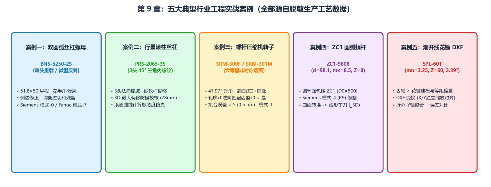

# 9. 工程实战案例

本章串联演示 5 个脱敏工业场景下 `绘图工具`、`工具箱`、`基本参数` 与 `高级参数` 的组合配置方案。

---

## 案例速查表

| 章节 | 标准代号 | 工件与齿形特征 | 核心工艺组合 | 程序模式 |
| :--- | :--- | :--- | :--- | :--- |
| **[9.1 案例一](./case1_double_arc_nut.md)** | `BNS-5250-2S` | 内螺纹双圆弧滚珠丝杠螺母（双头大导程） | `双圆弧`（微调）➔ `最大偏移`（防撞）➔ `侧边修正` | `模式-0` |
| **[9.2 案例二](./case2_planetary_triangle.md)** | `PRS-2065-3S` | 多头行星滚柱丝杠内齿圈（3 头，45° 半角） | `三角`（分填螺距与头数）➔ 滚轮半径钳制 | `模式-0` |
| **[9.3 案例三](./case3_compressor_rotor.md)** | `SRM-300F` / `SRM-301M` | 双螺杆压缩机阴阳转子（非对称端面） | `端面(左)` + `镜像` + `轮廓x0法向匹配齿型x0` + 65° 斜坡 | `模式-1` / `模式-0` |
| **[9.4 案例四](./case4_worm_and_lathe.md)** | `ZC1-9808` | ZC1 圆弧圆柱蜗杆（8 头，mx = 8.5 mm） | `ZC1` 建模 ➔ 精磨修整 / `曲线转换` ➔ `车刀计算` | `模式-4` / `-3D.html` |
| **[9.5 案例五](./case5_spline_dxf_fitting.md)** | `SPL-60T` | 60 齿渐开线花键与外部样条 DXF 清洗 | `花键`建模 + `DXF 变换`（独立缩放/平移）➔ `DXF 拟合圆弧` | `模式-0` / `模式-99` |

