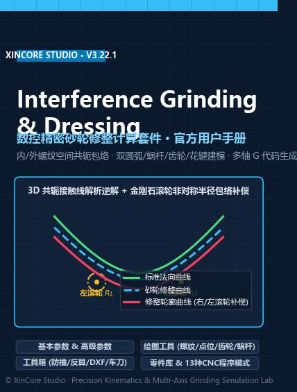

# IGD 磨削修整计算软件 用户操作手册

欢迎使用 **IGD 磨削修整计算软件（Interference Grinding & Dressing，v3.22.1）** 官方用户操作手册。

**IGD** 是一款面向高精度内/外螺纹、滚珠丝杠副、行星滚柱丝杠、双螺杆压缩机阴阳转子、多包络精密蜗杆（ZI / ZA / ZN1 / ZC1 / ZC2 / ZC3 / ZK1）以及渐开线齿轮/花键的**三维空间包络磨削干涉计算与数控修整宏程序生成软件**。软件基于空间啮合包络原理，自动消除大导程或小砂轮直径工况下的曲率干涉与过切，补偿左右金刚石滚轮圆弧半径，一键生成适配 **Siemens（西门子 `.SPF` / 加密 `.CPF`）**、**Fanuc（发那科 `O2010`）** 与 **Syntec（新代 `O2010.txt`）** 数控系统的多砂轮直径阶梯修整宏程序。

---

## 核心功能矩阵

| 功能模块 | 界面导航入口 | 核心能力概述 |
| :--- | :--- | :--- |
| **空间干涉磨削与数控修整计算** | `基本参数` + `高级参数` | 支持 `内螺纹` 与 `外螺纹`（含 `普通砂轮` 与 `内旋风铣` 两种 `外螺纹模式`）；支持 `砂轮杆偏移` 与 `砂轮直径` 双输入模式；自动完成三维螺旋面空间包络、左右 `滚轮圆弧半径` 补偿、双切圆弧拟合（`拟合圆弧`）及 13 种数控 `程序模式` 输出 |
| **多类型标准齿形参数化建模** | `绘图工具` | 涵盖 `螺纹`（`三角` / `梯形` / `双圆弧` 正向 `计算` 与逆向 `反算`）、`XY 点位文件`、`齿轮`（`渐开线`：`齿轮` / `花键`）与 `蜗杆`（`渐开线(ZI)`、`阿基米德(ZA)`、`齿槽法向(ZN1)`、`圆环面包络(ZC1)`、`特定交角包络(ZC2)`、`轴向圆弧齿(ZC3)`、`盘状锥面包络(ZK1)`） |
| **空间防撞与反演仿真分析** | `工具箱` | 包含 `最大偏移`（砂轮杆三维防撞仿真）、`滚道曲线计算`（已知修整砂轮反演实际磨削出的工件截面及误差）、`曲线转换`（`法向` / `轴向` / `端面(左)` 空间截面互转）与 `曲线误差对比`（亚微米级双曲线法向偏差统计） |
| **DXF 批处理与粗加工车刀设计** | `工具箱` | 包含 `DXF 处理`（`DXF 文件对比`、`DXF 离散化`、`DXF 拟合圆弧`、`DXF 等距线`、`DXF 变换`）与 `车刀计算`（考虑 `前角`、`侧倾角`、`侧倾角偏移` 的成形车刀法向刃口计算与三维交互式报表输出） |
| **企业级零件库与配置管理** | `工具` ➔ `零件库` | 支持完整加工工程参数、源齿形 DXF 与说明信息的归档管理，提供五列排序检索与一键 `导入` 回填 |

---

## 手册章节导览

* **[第 1 章 快速入门与界面导览](./1_getting_started/README.md)**：系统环境要求、四种授权激活方式（`加密狗` / `导入授权文件` / `硬件ID` / `账户登录`）、主界面双栏布局、输入框三色视觉编码规范，以及基于 `BNS-2020-R` 滚珠丝杠螺母的 3 分钟快速上手闭环。
* **[第 2 章 基本参数：工件、齿形与砂轮定义](./2_basic_params/README.md)**：`工件类型`、`螺纹旋向`、`工件中径`、`导程` 与自动螺旋升角计算，`DXF 齿型文件`（含 `*-info.txt` 自动关联读取）、`DXF 齿形类型`（`法向` / `轴向` / `端面(左)`）与 `镜像`，以及 `砂轮杆偏移` / `砂轮直径`、`砂轮直径间隔` 与 `砂轮安装角` 调优策略。
* **[第 3 章 高级参数：初始化配置与数控程序信息](./3_advanced_params/README.md)**：`滚轮圆弧半径`、`最终曲线点密度`、`螺旋面生成角度`、`齿高延长高度`、`齿根倒圆半径` 防过切钳制、`水平延长`、`拟合圆弧` 与 `拟合误差`；`外螺纹模式`（`普通砂轮` / `内旋风铣`）、`法向作为砂轮廓形`、`轮廓x0法向匹配齿型x0` 与 `Siemens程序加密`；以及 `程序模式`（`模式-0` ~ `模式-100` 共 13 种模板）完整参数矩阵。
* **[第 4 章 可视化交互画布与输出文件解析](./4_plots_and_outputs/README.md)**：右侧 6 大核心结果视图（`加载图形`、`间隔变化`、`圆弧拟合`、`干涉齿形`、`修形轮廓`、`模拟计算`）判读方法，以及 `.SPF` / `.CPF` / `O2010` / `O2010.txt` / `.dxf` / `.html` 等输出文件全解析。
* **[第 5 章 绘图工具：标准齿形与空间曲线建模](./5_drawing_tools/README.md)**：`螺纹`（`三角`、`梯形`、`双圆弧`）、`XY 点位文件`、`齿轮`（`渐开线`）与 `蜗杆`（7 种包络齿形）的数学建模参数、蓝底计算值（`#78a6bc`）与青绿修正框（`#6bb1aa`）实战指南。
* **[第 6 章 工具箱（一）：空间校验、滚道仿真与曲线分析](./6_toolbox_analysis/README.md)**：`最大偏移`、`滚道曲线计算`、`曲线转换` 与 `曲线误差对比` 四大仿真与精度校验工具详解。
* **[第 7 章 工具箱（二）：DXF 曲线工程处理与车刀设计](./7_toolbox_dxf_lathe/README.md)**：`DXF 处理` 五大子模块与 `车刀计算` 模块操作指南。
* **[第 8 章 零件库管理与系统设置](./8_menus_and_library/README.md)**：`工具 -> 零件库` 三文件归档结构与检索导入工作流，以及顶部菜单与 `~/.igd` 本地配置体系。
* **[第 9 章 典型工程实战案例集（5 大行业标准场景）](./9_workflows_cases/README.md)**：涵盖内螺纹双圆弧螺母、多头行星滚柱丝杠、压缩机阴阳转子、ZC1 蜗杆磨削与车刀设计、以及渐开线花键 DXF 逆向修整 5 大工业级端到端完整案例。
* **[第 10 章 常见报警排查与工程 FAQ](./10_troubleshooting/README.md)**：软件弹窗报警字典、过切与轮廓跳变排查手册、以及现场常见问题速查。
